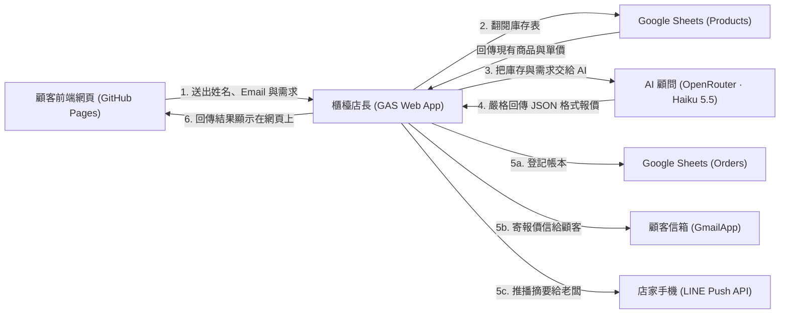

# 輕量級微電商 AI 導購與自動報價系統：實戰教師手冊（大學生小白專用版）

> [!NOTE]
> **本手冊適用對象與課程目標**
> 專為**無程式基礎或剛入門的大學生**設計。無需購買網域、無需租用雲端主機、無需安裝複雜開發環境（僅需瀏覽器），即可在 **3 小時內** 親手完成一個結合「靜態網頁 + 雲端試算表 + 生成式 AI + Email/LINE 自動通知」的真實微電商 MVP。

---

## 課前規劃：教學節奏與課堂配速表（建議 150～180 分鐘）

### 學生課前準備清單（建議開課前 1 天通知）

- [ ] **筆電一台**（Windows 或 Mac 皆可，不建議用平板操作程式碼）。
- [ ] **個人 Google 帳號**（需可使用 Google 試算表與 Gmail，**請勿使用學校受限的 G Suite 教育帳號**，部分學校帳號會封鎖外部 Apps Script 部署）。
- [ ] **LINE 帳號 + 智慧型手機**（需於課堂中掃描 QR Code 加機器人好友）。
- [ ] **GitHub 帳號**（若尚未註冊，請先至 [GitHub](https://github.com/) 完成註冊與信箱驗證，避免課堂卡關）。

### 課堂時間配速建議（共 180 分鐘）

| 時間區段 | 教學單元 | 講師授課重點與學生活動 | 講師巡堂關鍵檢核點 |
| :--- | :--- | :--- | :--- |
| **00–20 分** | 單元一｜架構與白話比喻 | 用「咖啡廳點餐」比喻講解前後端、API Key 資安觀念與 JSON 格式 | 確認所有同學理解為何 Key 不能放前端 |
| **20–50 分** | 單元二｜申請雙系統金鑰 | 引導申請 OpenRouter API Key 與 LINE Messaging API 憑證 | **重點救火**：檢查 User ID 是否為 `U` 開頭、是否已掃碼加好友 |
| **50–70 分** | 單元三｜Google Sheets 資料庫 | 建立試算表、`Products` 與 `Orders` 分頁及測試資料 | 確認分頁大小寫精準、單價欄位為純數字 |
| **70–115 分** | 單元四｜GAS 後端與部署 | 貼上程式碼、執行 Google 授權、部署 `/exec` 網址並試跑單元測試 | **重點救火**：卡在「應用程式未經驗證」畫面的授權步驟 |
| **115–155 分** | 單元五｜前端與 GitHub Pages | 建立 `index.html`、替換網址、透過 GitHub 上傳並開啟 Pages | **重點救火**：避免 Windows `.html.txt` 副檔名陷阱 |
| **155–180 分** | 單元六｜驗收、除錯與改裝 | 全班互相下單測試、F12 Console 除錯教學、示範改賣別的商品 | 鼓勵同學自由修改主題作為課後加分題 |

---

## 單元一｜系統架構與白話概念解析（台上講解用）

### 1. 用「精品咖啡廳」聽懂全系統架構

對沒有寫過前後端的同學，可以先用實體店面做一對一類比：

| 系統元件 | 使用工具 | 咖啡廳角色比喻 | 負責的工作 |
| :--- | :--- | :--- | :--- |
| **前端網頁** | GitHub Pages (`index.html`) | **店門口的電子菜單 / 點餐機** | 給顧客看商品、讓顧客輸入預算與需求，並顯示最後報價 |
| **後端中樞** | Google Apps Script (GAS) | **櫃檯萬能店長** | 收到點單後，去倉庫查庫存、問 AI 顧問、記帳、寄信跟通知老闆 |
| **資料庫** | Google Sheets | **倉庫庫存表 (`Products`) ＋ 帳本 (`Orders`)** | 紀錄現在有什麼商品、多少錢、以及誰來問過價錢 |
| **AI 大腦** | OpenRouter API (`anthropic/claude-haiku-5.5`) | **資深咖啡導購顧問** | 讀懂顧客模糊的需求（如「送愛喝拿鐵的同事」），從庫存裡挑對東西並算總價 |
| **顧客通知** | `GmailApp` | **開立正式收據信件** | 自動寄一封排版整齊的報價單給顧客 |
| **店家通知** | LINE Messaging API | **老闆手機的收單提醒** | 有客人真的詢價才發推播（節省每月 200 則免費額度） |

### 2. 系統資料流向圖（5～8 秒內發生了什麼事？）



### 3. 大學生必懂的兩個核心觀念（小白破冰）

1. **為什麼要多此一舉經過 GAS，不直接從網頁呼叫 OpenRouter？**
   - **資安原因**：網頁程式碼（HTML / JS）任何人都只要按右鍵「檢視網頁原始碼」就看得到。如果把 OpenRouter API Key 寫在前端，你的帳號額度幾分鐘內就會被爬蟲盜刷光！把金鑰藏在 GAS（後端），顧客永遠看不到你的鑰匙。
2. **什麼是 JSON？為什麼要「強制 AI 回傳 JSON」？**
   - 平常跟 AI 聊天，它會回一大段溫暖但格式不固定的文章，程式很難把「總金額」單獨抓出來算帳。
   - JSON 就像一張「統一格式的表格」，透過 OpenRouter 的 `response_format: { type: "json_object" }` 規定 Claude Haiku 5.5 只能填入 `recommended_items`（推薦清單）、`total_price`（純數字總額）、`reply_message`（導購話術）三個格子，這樣後端才能精準把總額寫進試算表並寄出信件。

---

## 單元二｜事前準備（申請 2 組金鑰）

> [!TIP]
> **課堂動手前先做這件事**
> 請學生先在電腦開一個「記事本」或「便利貼」，接下來取得的 **3 段神祕字串** 都要先貼在裡面暫存，**切勿隨意加上多餘的空白鍵或換行**，也不要直接投影自己的金鑰在螢幕上。

### 1. 取得 OpenRouter API Key（AI 萬用大腦通行證）

1. 前往 [OpenRouter](https://openrouter.ai/)，點擊右上角 **Sign in**，可直接使用 **Google 或 GitHub 帳號**登入。
2. 點擊右上角頭像 → **Keys**（或前往 `openrouter.ai/settings/keys`）→ 點擊 **Create Key**。
3. 輸入名稱（例如 `ai-shop-mvp`）後點擊建立（若由老師課堂配發限額金鑰，可略過此步）。
4. 畫面上會出現一串以 **`sk-or-v1-...`** 開頭的金鑰字串，**請立即複製並貼到記事本備用**（OpenRouter 只會完整顯示這一次，關閉視窗就看不到了！）。

### 2. 取得 LINE 推播憑證（手機收通知用）

1. 前往 [LINE Developers Console](https://developers.line.biz/)，點擊右上角 **Log in**，選擇「使用 LINE 帳號登入」並用手機認證。
   - *若是首次登入的新手*，系統會要求填寫開發者名稱（隨意英文或中文）與 Email 建立帳號，填完送出即可。
2. 進入主控台後，建立一個 **Provider**（想像成「公司或工作室名稱」，例如：`MyShop`）→ 點擊 **Create**。
3. 接著畫面會出現多種服務選項，**請務必選擇「Create a Messaging API channel」**。
   > [!WARNING]
   > **小白常見誤點**：請提醒學生不要點到「LINE Login」，一定要選 **Messaging API** 才會有機器人推播功能！
4. 填寫建立表單（有紅色星號 `*` 的必填即可）：
   - **Channel name**：機器人名稱（例如：`咖啡小幫手`）
   - **Channel description**：簡單說明（例如：`自動報價通知機器人`）
   - **Category / Subcategory**：隨意選擇一個分類（例如：`Shopping`）
   - 勾選下方兩項服務條款後點擊 **Create** → **OK** → **Agree**。
5. 建立完成後，在該 Channel 設定頁取得以下**兩組資料**貼到記事本：

| 需複製的資料 | 點擊哪個頁籤 | 在頁面的哪個位置 | 認明格式特徵（防呆檢查） |
| :--- | :--- | :--- | :--- |
| **1. Your user ID** | `Basic settings` | 滑到**最下方** | 必須是 **`U` 開頭**的一長串英數字（例如 `U1a2b3c...`）<br>❌ **千萬不要複製到最上方的純數字 Channel ID！** |
| **2. Channel access token** | `Messaging API` | 1. 先找到頁面上方的 **QR Code**，**用自己手機 LINE 掃描加為好友**<br>2. 再滑到頁面**最下方**，點擊 **Issue** 按鈕 | 產生後點擊複製圖示（非常長的一串英數字） |

> [!TIP]
> **加分小動作（讓機器人更專業）**：掃碼加好友後，如果學生傳訊息給機器人，預設會收到官方罐頭自動回覆。可選做：點擊頁面上的「LINE Official Account Manager」連結 → 設定 → 回應設定 → 關閉「自動回應訊息」。

---

## 單元三｜步驟一：建立 Google Sheets 資料庫

1. 開啟 [Google 試算表](https://sheets.new/)（此連結會直接幫你開好一份新試算表）。
2. 點擊左上角「未命名的試算表」，將檔案命名為 **`AI微電商資料庫`**。

### 1. 設定第一個分頁：`Products`（商品倉庫）

1. 看向畫面**最左下角**的「工作表1」，在上面按右鍵（或雙擊兩下）→ **重新命名** → 輸入 **`Products`**（`P` 大寫，後面全小寫，不可有多餘空白）。
2. 依序在第一列（標題）與第 2～5 列輸入測試商品：

| 列 \ 欄 | A（商品編號） | B（商品名稱） | C（單價） | D（庫存狀態） | E（商品特色說明） |
| :---: | :--- | :--- | :--- | :--- | :--- |
| **1** | 商品編號 | 商品名稱 | 單價 | 庫存狀態 | 商品特色說明 |
| **2** | `P01` | 淺焙耶加雪菲濾掛盒 | `350` | 充足 | 果香明顯、酸質明亮，適合喜歡清爽口感或早晨飲用 |
| **3** | `P02` | 曼巴中深焙咖啡豆(半磅) | `450` | 充足 | 堅果與巧克力尾韻、不酸且醇厚，適合加牛奶或辦公室沖泡 |
| **4** | `P03` | 手沖不鏽鋼細口壺 | `890` | 充足 | 600ml 穩定水流設計，適合新手練習手沖 |
| **5** | `P04` | 質感陶瓷保溫隨行杯 | `680` | 充足 | 真瓷內膽不留異味，適合通勤族與節日送禮 |

> [!IMPORTANT]
> **試算表小白防呆檢查**
> - **C 欄（單價）請輸入純數字**（如 `350`），不要打 `$350` 或 `350元`，方便 AI 正確加總金額。
> - 如果覺得一行行複製太慢，老師可預先準備一份試算表範本連結，讓同學「檔案 → 建立副本」直接複製，能省下 10 分鐘打字時間！

### 2. 設定第二個分頁：`Orders`（訂單帳本）

1. 點擊左下角的「**＋**」（新增工作表）。
2. 將新分頁「工作表2」重新命名為 **`Orders`**（`O` 大寫，後面全小寫，不可有多餘空白）。
3. 只須填寫**第一列標題欄位**（第 2 列以後會由系統自動寫入）：

| A1 | B1 | C1 | D1 | E1 | F1 | G1 |
| :--- | :--- | :--- | :--- | :--- | :--- | :--- |
| 時間 | 客戶姓名 | 客戶Email | 客戶原始需求 | AI推薦商品與數量 | 預估總金額 | AI導購回覆內容 |

---

## 單元四｜步驟二：撰寫與部署 GAS 後端程式碼

### 1. 開啟編輯器並貼上程式碼

1. 回到剛才的 Google 試算表上方選單，點擊 **擴充功能** → **Apps Script**（會開出一個新分頁）。
2. 可點擊左上角「未命名的專案」，改名為 **`AI導購後端`**。
3. 將右側編輯器裡面原本的 `function myFunction() { ... }` **全選刪除**，讓編輯區完全空白。
4. 完整複製以下程式碼並貼上，接著把**第 2～4 行引號內的文字**替換成單元二申請好的金鑰（**注意保留雙引號 `"`**）：

```javascript
// ====== 1. 填入你的專屬金鑰（請保留雙引號） ======
const OPENROUTER_API_KEY = "貼上你的_OPENROUTER_API_KEY";
const LINE_ACCESS_TOKEN = "貼上你的_LINE_CHANNEL_ACCESS_TOKEN";
const LINE_ADMIN_USER_ID = "貼上你的_LINE_USER_ID_U開頭";

// ====== 2. 接收前端網頁 POST 請求的主程式 ======
function doPost(e) {
  try {
    // 解析前端傳來的純文字 JSON (繞過 CORS 預檢請求)
    const params = JSON.parse(e.postData.contents);
    const customerName = params.name || "訪客";
    const customerEmail = params.email || "";
    const userRequirement = params.requirement || "";

    if (!userRequirement || !customerEmail) {
      return createJsonResponse({ status: "error", message: "請填寫完整需求與 Email" });
    }

    // 步驟 A：讀取 Products 分頁的商品目錄
    const catalogText = getProductCatalog();

    // 步驟 B：呼叫 OpenRouter (Claude Haiku 5.5) 進行導購分析與報價計算
    const aiResult = callOpenRouterAI(catalogText, userRequirement);

    // 步驟 C：將詢價結果寫入 Orders 分頁
    saveOrderToSheet(customerName, customerEmail, userRequirement, aiResult);

    // 步驟 D：自動寄送報價單 Email 給客戶
    sendQuoteEmail(customerName, customerEmail, aiResult);

    // 步驟 E：推播通知到店家 LINE 手機
    sendLineNotification(customerName, userRequirement, aiResult);

    // 回傳成功結果給前端網頁顯示
    return createJsonResponse({
      status: "success",
      data: aiResult
    });
  } catch (error) {
    return createJsonResponse({
      status: "error",
      message: error.toString()
    });
  }
}

// ====== 輔助函式 A：讀取試算表商品資料 ======
function getProductCatalog() {
  const sheet = SpreadsheetApp.getActiveSpreadsheet().getSheetByName("Products");
  const rows = sheet.getDataRange().getValues();
  let catalog = [];
  for (let i = 1; i < rows.length; i++) {
    catalog.push(`編號:${rows[i][0]} | 名稱:${rows[i][1]} | 單價:${rows[i][2]}元 | 庫存:${rows[i][3]} | 說明:${rows[i][4]}`);
  }
  return catalog.join("\n");
}

// ====== 輔助函式 B：呼叫 OpenRouter API · Claude Haiku 5.5 (強制回傳 JSON) ======
function callOpenRouterAI(catalogText, userRequirement) {
  const url = "https://openrouter.ai/api/v1/chat/completions";
  const prompt = `
請根據以下【現有商品目錄】，針對【客戶需求】配置最適合的商品組合與數量，並計算總價。
不可捏造目錄以外的商品。

【現有商品目錄】
${catalogText}

【客戶需求】
${userRequirement}

請嚴格遵守以下 JSON 格式回傳，不要包含任何 Markdown 標記（例如 \`\`\`json）或其他說明文字：
{
  "recommended_items": "商品名稱 x 數量 (單價) 的清單字串",
  "total_price": 總金額數字,
  "reply_message": "給客戶的專業推薦理由與貼心建議（約 80 字內）"
}`;

  const payload = {
    model: "anthropic/claude-haiku-5.5",
    messages: [
      {
        role: "system",
        content: "你是一位專業的電商導購顧問，只回傳合法的純 JSON 物件，不可輸出任何額外說明或 Markdown 程式碼區塊。"
      },
      {
        role: "user",
        content: prompt
      }
    ],
    response_format: {
      type: "json_object"
    }
  };
  const options = {
    method: "post",
    contentType: "application/json",
    headers: {
      "Authorization": "Bearer " + OPENROUTER_API_KEY,
      "HTTP-Referer": "https://github.com/ai-shop-mvp",
      "X-Title": "AI Shop MVP"
    },
    payload: JSON.stringify(payload),
    muteHttpExceptions: true
  };

  const response = UrlFetchApp.fetch(url, options);
  const json = JSON.parse(response.getContentText());
  if (json.error) {
    throw new Error("OpenRouter API Error: " + (json.error.message || JSON.stringify(json.error)));
  }
  const rawText = json.choices[0].message.content.trim();
  const cleanText = rawText.replace(/^```json\s*/i, "").replace(/^```\s*/i, "").replace(/```$/i, "").trim();
  return JSON.parse(cleanText);
}

// ====== 輔助函式 C：寫入訂單紀錄 ======
function saveOrderToSheet(name, email, req, aiResult) {
  const sheet = SpreadsheetApp.getActiveSpreadsheet().getSheetByName("Orders");
  sheet.appendRow([
    new Date(),
    name,
    email,
    req,
    aiResult.recommended_items,
    aiResult.total_price,
    aiResult.reply_message
  ]);
}

// ====== 輔助函式 D：寄送 Email 報價單給客戶 ======
function sendQuoteEmail(name, email, aiResult) {
  const subject = `【AI 智能報價單】感謝 ${name} 的詢價`;
  const body = `${name} 您好：\n\n感謝您的詢價！根據您的需求，系統為您配置的最佳組合如下：\n\n` +
    `▪ 推薦項目：${aiResult.recommended_items}\n` +
    `▪ 預估總額：NT$ ${aiResult.total_price} 元\n\n` +
    `【專屬導購建議】\n${aiResult.reply_message}\n\n` +
    `若確認訂購，請直接回覆此信件，我們將盡快為您安排出貨！`;

  GmailApp.sendEmail(email, subject, body);
}

// ====== 輔助函式 E：發送 LINE Push 通知給店家 ======
function sendLineNotification(name, req, aiResult) {
  if (LINE_ACCESS_TOKEN.includes("貼上")) return; // 若未填寫則略過
  const url = "https://api.line.me/v2/bot/message/push";
  const messageText = `🔔 新詢價單通知！\n` +
    `客戶：${name}\n` +
    `需求：${req}\n` +
    `----------------\n` +
    `AI 配單：${aiResult.recommended_items}\n` +
    `預估金額：$${aiResult.total_price} 元`;

  const payload = {
    to: LINE_ADMIN_USER_ID,
    messages: [{ type: "text", text: messageText }]
  };
  const options = {
    method: "post",
    contentType: "application/json",
    headers: { Authorization: "Bearer " + LINE_ACCESS_TOKEN },
    payload: JSON.stringify(payload),
    muteHttpExceptions: true
  };
  UrlFetchApp.fetch(url, options);
}

// ====== 輔助函式 F：包裝回傳格式 ======
function createJsonResponse(obj) {
  return ContentService.createTextOutput(JSON.stringify(obj))
    .setMimeType(ContentService.MimeType.JSON);
}
```

5. 按下 **`Ctrl + S`**（Mac 為 `Cmd + S`）存檔，確認專案名稱旁的橘色小圓點消失。

### 2. 【講師秘訣】先做 1 分鐘後端測試（大幅降低課堂除錯難度）

> [!TIP]
> 建議讓學生在部署網頁前，先用內建按鈕測試一次試算表、OpenRouter (Haiku 5.5) 與 LINE 是否都打通！若此時出錯，就能立刻知道是金鑰問題還是分頁拼字問題，不用等到最後才混在一起抓蟲。

做法：請學生在程式碼**最下方**暫時貼上這 6 行測試函式，存檔後在上方工具列下拉選單選擇 **`testBackend`** 並點擊 **執行**：

```javascript
function testBackend() {
  const catalog = getProductCatalog();
  const aiResult = callOpenRouterAI(catalog, "預算 1000 元，想買手沖入門組");
  Logger.log(aiResult);
  sendLineNotification("課堂測試員", "預算 1000 元，想買手沖入門組", aiResult);
}
```

- 首次按執行就會觸發下方「Google 授權視窗」，趁機全班一起走完授權流程。
- 看到下方「執行記錄」印出商品推薦 JSON、且手機收到 LINE 通知，就代表後端 **100% 通了**！

### 3. 完成 Web App 部署（新手最常卡關的授權流程）

1. 點擊編輯器右上角藍色按鈕 **部署** → **新增部署作業**。
2. 點擊左上角齒輪圖示「選取類型」→ 勾選 **網頁應用程式（Web App）**。
3. 設定下方兩個必要選項（**少選一個前端就會連線失敗**）：
   - **執行身分**：選擇 **`我 (你的信箱)`**
   - **誰可以存取**：選擇 **`所有人 (Anyone)`**
4. 點擊 **部署**。若先前尚未授權，會跳出授權提示，請全班跟著以下 5 步走（告訴同學：**這不是中毒，是 Google 提醒你正在執行自己寫的程式**）：
   1. 點擊 **核對權限**
   2. 選擇自己的 Google 帳號
   3. 出現「Google 尚未驗證這個應用程式」警告畫面時，點擊左下角灰色小字 **進階 (Advanced)**
   4. 點擊最下方展開的 **前往「AI導購後端」(不安全)**
   5. 滑到最下方點擊 **允許 (Allow)**
5. 部署成功後，複製「**網頁應用程式**」下方的網址並貼到記事本備用。

> [!CAUTION]
> **兩大鐵律提醒學生**
> 1. 複製的網址必須以 **`/exec`** 結尾（千萬不要複製瀏覽器上方網址列的 `/edit` 網址）。
> 2. 以後只要有修改 GAS 裡的任何一行字，**光按 Ctrl+S 不會生效**！必須點擊 **部署 → 管理部署作業 → 右上角鉛筆圖示 → 版本選「新版本」→ 按下部署**。

---

## 單元五｜步驟三：建立前端網頁並發布至 GitHub Pages

### 1. 準備 `index.html`（避開 Windows / Mac 副檔名陷阱！）

對於沒有用過 VS Code 的小白學生，**最容易發生「在桌面建了記事本卻變成 `index.html.txt`」或「Mac 文字編輯存成 RTF 亂碼檔」**。課堂上建議直接採用以下**零踩雷方法（直接在 GitHub 網頁建立檔案）**，或引導使用「另存新檔」：

#### 方法 A（最推薦・零踩雷）：直接在 GitHub 網頁新增 `index.html`

1. 登入 [GitHub](https://github.com/)，點擊右上角「**＋**」→ **New repository**。
2. 填寫設定：
   - **Repository name**：輸入 `ai-shop-mvp`
   - 選擇 **Public**（公開，免費版 GitHub Pages 必選）
   - 勾選 **Add a README file**
   - 點擊綠色按鈕 **Create repository**。
3. 進入儲存庫頁面後，點擊右上方 **Add file** → **Create new file**（直接線上建立檔案，免除電腦副檔名與編碼問題）。
4. 在上方檔名輸入框（`Name your file...`）輸入 **`index.html`**。
5. 將下方完整 HTML 程式碼貼進編輯區，並記得將 `<script>` 內的 **`GAS_WEB_APP_URL`** 替換為單元四複製的 `/exec` 網址：

```html
<!DOCTYPE html>
<html lang="zh-TW">
<head>
  <meta charset="UTF-8">
  <meta name="viewport" content="width=device-width, initial-scale=1.0">
  <title>AI 智能微電商導購與自動報價</title>
  <style>
    body { font-family: sans-serif; max-width: 600px; margin: 40px auto; padding: 0 20px; line-height: 1.6; color: #333; }
    .card { border: 1px solid #ddd; border-radius: 8px; padding: 20px; margin-bottom: 20px; background: #fafafa; }
    label { display: block; margin-top: 12px; font-weight: bold; }
    input, textarea { width: 100%; padding: 10px; margin-top: 6px; border: 1px solid #ccc; border-radius: 4px; box-sizing: border-box; }
    button { margin-top: 20px; width: 100%; padding: 12px; background: #0066cc; color: white; border: none; border-radius: 4px; font-size: 16px; cursor: pointer; }
    button:disabled { background: #999; cursor: not-allowed; }
    #resultBox { display: none; border-left: 5px solid #28a745; background: #e9f7ef; padding: 15px; margin-top: 20px; }
  </style>
</head>
<body>
  <h2>☕ 精品咖啡館：AI 智能配單與詢價</h2>

  <div class="card">
    <strong>📦 現貨商品一覽：</strong>
    <ul>
      <li>淺焙耶加雪菲濾掛盒 — $350</li>
      <li>曼巴中深焙咖啡豆 (半磅) — $450</li>
      <li>手沖不鏽鋼細口壺 — $890</li>
      <li>質感陶瓷保溫隨行杯 — $680</li>
    </ul>
  </div>

  <div class="card">
    <label>您的稱呼</label>
    <input type="text" id="name" placeholder="例如：王小明" required>

    <label>接收報價單的 Email</label>
    <input type="email" id="email" placeholder="例如：example@gmail.com" required>

    <label>請告訴 AI 您的預算與採購需求</label>
    <textarea id="requirement" rows="3" placeholder="例如：預算 1500 元以內，想買送給愛喝拿鐵同事的生日禮物，請幫我搭配。"></textarea>

    <button id="submitBtn" onclick="submitInquiry()">✨ 產生 AI 專屬報價單</button>
  </div>

  <div id="resultBox">
    <h3>✅ AI 專屬配單結果（報價單已同步寄至您的信箱）</h3>
    <p><strong>推薦組合：</strong><span id="resItems"></span></p>
    <p><strong>預估總額：</strong>NT$ <span id="resPrice"></span> 元</p>
    <p><strong>導購建議：</strong><span id="resReply"></span></p>
  </div>

  <script>
    // ====== 貼上你的 GAS 網頁應用程式網址 ======
    const GAS_WEB_APP_URL = "貼上你的_GAS_WEB_APP_URL";

    async function submitInquiry() {
      const name = document.getElementById("name").value.trim();
      const email = document.getElementById("email").value.trim();
      const requirement = document.getElementById("requirement").value.trim();
      const btn = document.getElementById("submitBtn");
      const resultBox = document.getElementById("resultBox");

      if (!name || !email || !requirement) {
        alert("請填寫所有欄位！");
        return;
      }

      // 鎖定按鈕避免重複點擊
      btn.disabled = true;
      btn.innerText = "⏳ AI 正在計算庫存與生成報價單（約需 5~8 秒）...";
      resultBox.style.display = "none";

      try {
        // 關鍵技巧：使用 text/plain 避開瀏覽器 CORS 預檢請求錯誤
        const response = await fetch(GAS_WEB_APP_URL, {
          method: "POST",
          headers: { "Content-Type": "text/plain;charset=utf-8" },
          body: JSON.stringify({ name, email, requirement })
        });
        const result = await response.json();

        if (result.status === "success") {
          document.getElementById("resItems").innerText = result.data.recommended_items;
          document.getElementById("resPrice").innerText = result.data.total_price;
          document.getElementById("resReply").innerText = result.data.reply_message;
          resultBox.style.display = "block";
        } else {
          alert("系統發生錯誤：" + result.message);
        }
      } catch (err) {
        alert("連線失敗，請檢查 GAS 網址或部署權限是否設為所有人。");
      } finally {
        btn.disabled = false;
        btn.innerText = "✨ 產生 AI 專屬報價單";
      }
    }
  </script>
</body>
</html>
```

6. 點擊右上角綠色按鈕 **Commit changes...** → 再按一次 **Commit changes** 存檔。

#### 方法 B（若使用本機電腦建立後上傳）

- 若用 Windows 記事本：點擊「檔案 → 另存新檔」，**存檔類型務必選「所有檔案 (*.*)」**，檔名輸入 `index.html`，編碼選 `UTF-8`。
- 若用 Mac：請勿使用內建「文字編輯 (TextEdit)」預設格式，建議使用 VS Code 或直接使用方法 A。
- 存檔後在 GitHub 儲存庫點 **Add file** → **Upload files** 上傳並 Commit。

### 2. 開啟 GitHub Pages 網站

1. 點擊儲存庫上方選單的 **Settings**（齒輪圖示）。
2. 在左側選單找到並點擊 **Pages**。
3. 在 **Build and deployment** 區塊下的 **Branch** 下拉選單，將 `None` 改為 **`main`**，點擊旁邊的 **Save**。
4. **等待約 1 分鐘後重新整理頁面**（可請同學趁這 1 分鐘喝水休息），頁面上方就會出現綠色或藍色框顯示你的網站網址：
   `https://你的帳號.github.io/ai-shop-mvp/`

---

## 單元六｜驗收測試、課堂除錯與延伸作業

### 1. 四點連線驗收檢核表（讓同學互相交換網址下單測試！）

- [ ] **前端畫面**：在自己或同學的網頁輸入姓名、Email 與需求（例如：「預算 1500 元，送愛喝黑咖啡的教授」），按鈕轉圈 5～8 秒後出現綠色推薦框。
- [ ] **試算表帳本**：打開 Google Sheets 的 `Orders` 分頁，確認多了一筆剛剛送出的完整資料。
- [ ] **顧客信箱**：去剛剛填的 Gmail 信箱（若沒看到請順便檢查「垃圾郵件」或「促銷內容」分類），確認收到 AI 報價信。
- [ ] **老闆手機**：檢查店家自己的 LINE，確認收到 `🔔 新詢價單通知！`。

### 2. 教小白第一步怎麼自己抓蟲（`F12` 除錯心法）

在網頁按 `F12`（Mac 為 `Cmd + Option + I`）切換到 **Console（主控台）** 或 **Network（網路）** 頁籤。只要出現紅字，截圖或複製訊息對照下表即可定位 90% 的問題：

| 錯誤現象 | 真實原因 | 課堂快速排除方式 |
| :--- | :--- | :--- |
| 前端跳出「連線失敗」或 Console 顯示 **CORS Error** | 1. GAS 部署權限未設為「所有人」<br>2. `GAS_WEB_APP_URL` 貼錯（貼成編輯器 `/edit` 網址）<br>3. 學校 Google 帳號限制外部存取 | 1. 改用個人 Gmail 帳號建立試算表<br>2. 重新部署確認「誰可以存取」為 **所有人**<br>3. 確認網址以 **`/exec`** 結尾 |
| 系統發生錯誤：`OpenRouter API Error` 或 `choices` 未定義 | OpenRouter API 回傳失敗（通常是 `sk-or-v1-` 金鑰貼錯、前後有空白，或帳號 Credits 餘額不足） | 檢查 GAS 第 2 行 Key 是否多出空白或引號被刪掉；確認 OpenRouter 帳號餘額或限額正常 |
| GAS 出現 `Cannot read properties of null (reading 'getDataRange')` | Google 試算表分頁名稱拼錯 | 檢查左下角兩個分頁名稱是否精準為 **`Products`** 與 **`Orders`**（大小寫與空白須完全一致） |
| 修改了 GAS 程式碼，但網頁測起來還是舊的結果 | GAS 改完程式碼只按了存檔，沒有發佈新版本 | 點擊右上角 **部署 → 管理部署作業 → 鉛筆圖示 → 版本選「新版本」→ 部署** |
| 網頁有顯示 AI 結果，但 LINE 沒收到通知 | 1. 忘記先加自己的 LINE Bot 為好友<br>2. `LINE_ADMIN_USER_ID` 填成 Channel ID 而非 `U` 開頭個人 ID | 手機掃描後台 QR Code 加好友；到 `Basic settings` **最下方**複製 `U` 開頭的 Your user ID |
| 按「產生報價單」沒反應、或網頁打開直接看到一堆 HTML 原始碼 | 檔名被電腦存成 `index.html.txt`，或用 Mac TextEdit 存成 RTF 格式 | 建議直接在 GitHub 網頁使用 **Create new file** 重新建立 `index.html` |

---

### 3. 課堂變形與加分作業（給進度較快或當作期末專題）

鼓勵大學生把這套骨架改裝成自己感興趣的商店主題（例如：**二手教科書小舖、宿舍零食箱、健身補給品、社團周邊、美妝試用組合**），只需修改兩個地方：

1. **基礎改裝（10 分鐘完成）**：
   - 修改 Google Sheets `Products` 的商品清單。
   - 修改 `index.html` 的店名、現貨一覽文字、以及 GAS `callOpenRouterAI` 裡的「顧問角色設定」（把「電商咖啡導購顧問」換成對應行業角色）。
2. **進階挑戰題 A（防呆邏輯強化）**：
   - 試著修改 GAS 的 `prompt`，加上一條規則：「*若某商品的庫存狀態為「缺貨」或「0」，絕對不可推薦該商品給顧客。*」並把試算表其中一項改為「缺貨」實測看看。
3. **進階挑戰題 B（前後端商品同步）**：
   - 目前 `index.html` 的商品列表是寫死在 HTML 裡的，如果試算表漲價了網頁不會自己變。可提示進度快的學生查閱 GAS 的 **`doGet()`** 函式，讓網頁一載入就自動向 Google Sheets 讀取最新商品列表！
